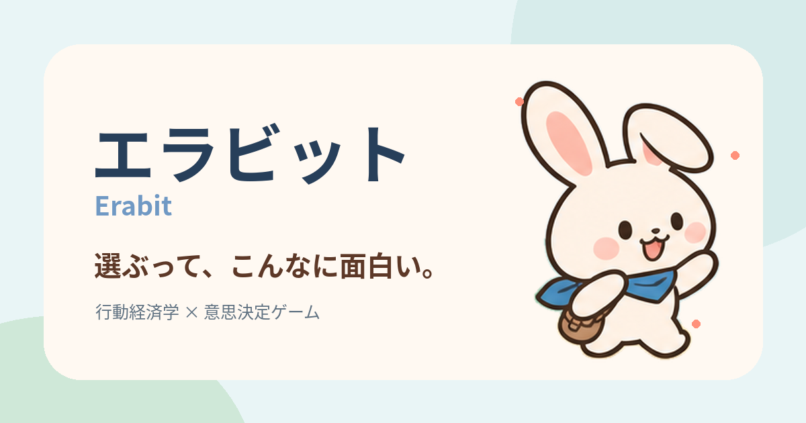
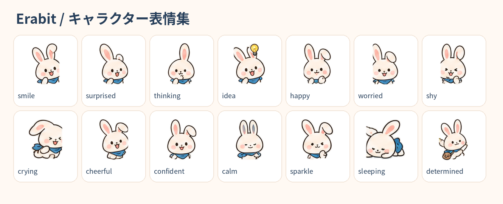
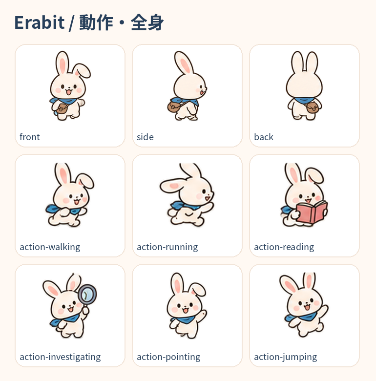
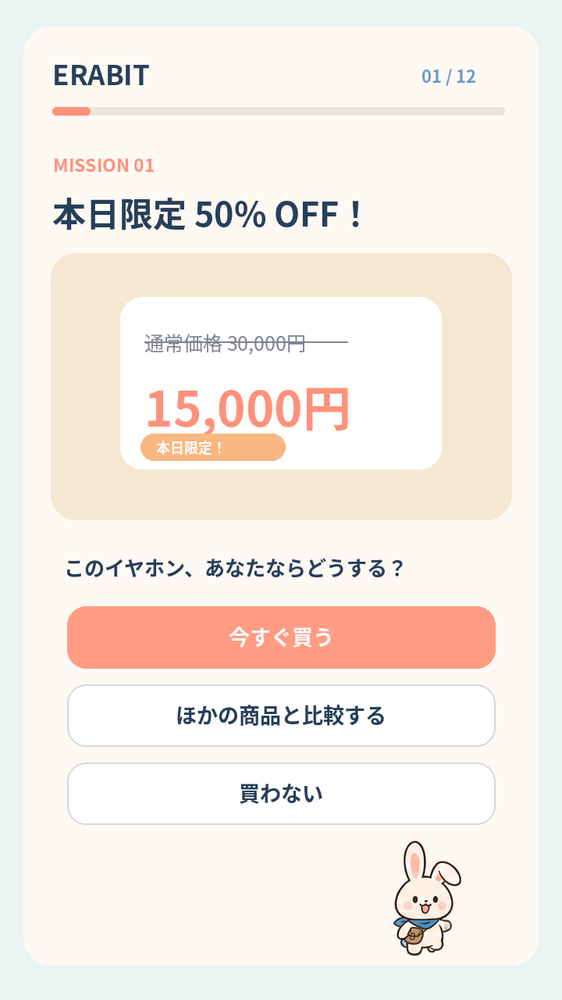

# エラビット（Erabit）🐰

**選ぶって、こんなに面白い。**

現実の出来事や日常の意思決定を題材に、自分の判断のクセを発見する行動経済学ゲーム。

## どんなゲーム？

- 買い物、仕事、SNSなどの場面で、自分ならどうするか選ぶ。
- 選択後に新しい情報が明らかになり、判断に影響する心理効果を知る。
- 発見したテーマが図鑑に集まり、過去の選択を振り返れる。
- かわいらしい白ウサギ「エラ」と一緒に、気軽に学べる。

**心理テストや診断ではありません。** 1回の回答だけで個人のバイアスを断定せず、自分の判断について考えるきっかけを提供します。

## MVPの概要

| 項目 | 内容 |
| --- | --- |
| 対応 | Web / スマホ優先 / PC対応 |
| コンテンツ | 12ミッション、5つの学習テーマ |
| 所要時間 | 1ミッション約1〜2分 |
| ゲーム | 選択 → 結果 → 種明かし → 振り返り |
| 保存 | ブラウザ内のローカル保存 |
| ログイン | 不要 |

## ドキュメント

- [MVP仕様書](docs/MVP.md)
- [キャラクター・ビジュアルガイド](docs/CHARACTER_GUIDE.md)
- [画像アセット集](assets/README.md)

## キャラクター

## 画面イメージ

## 開発計画

**Phase 1：** まず3ミッションで、プレイヤーが「選んで発見する」体験の面白さを検証。

**Phase 2：** 12ミッション、図鑑、回答履歴、進行保存を備えたMVPを公開。

技術方針：React / TypeScript / Vite / Tailwind CSS / Motion / localStorage。バックエンドなしで公開可能な構成を想定しています。

## このリポジトリについて

現段階では仕様書とコンセプト画像のパッケージであり、実装済みのゲームではありません。キャラクターの画像はMVP検討用のAI生成・切り出し素材です。画像中の細かな表現は必要に応じて再調整します。

**ライセンスは未設定です。** コード・画像素材の利用条件は、公開時に別途明示します。
