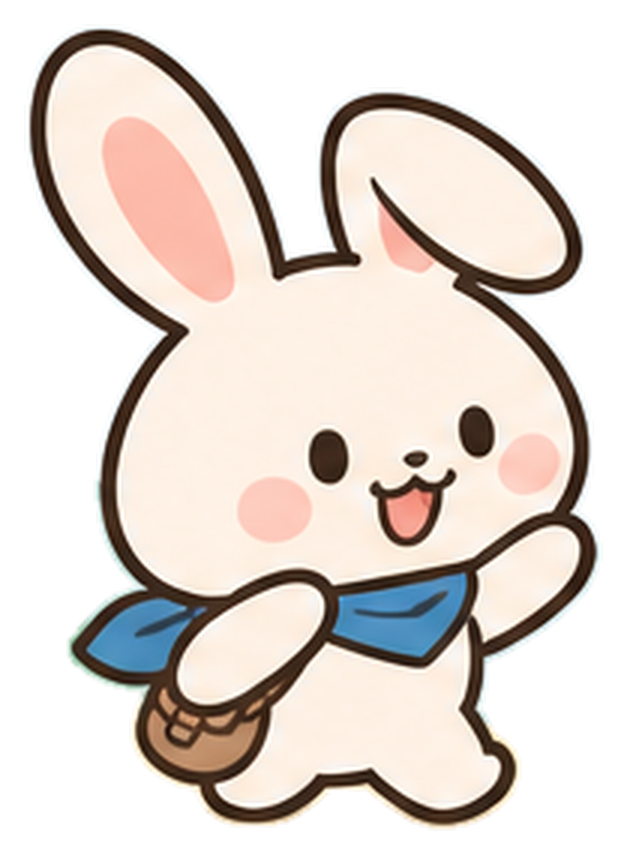

# Erabit — キャラクター／ビジュアルガイド（v0.1）

## エラの設定

- **名前**：エラ（Erabitの案内役）
- **モチーフ**：白ウサギ
- **性格**：好奇心旺盛、前向き、ちょっとおっちょこちょい
- **役割**：プレイヤーと一緒に意思決定を考え、気づきを共有する相棒
- **特徴**：大きな耳（一方が少し垂れている）、ピンクの頬、青いスカーフ、小さな茶色の肩掛けバッグ

### 表情・振る舞い

- **通常**：プレイヤーに選択を促す。
- **驚く**：意外な結果が出た時に耳がピンと立つ。
- **考える**：少し首を傾ける。
- **ひらめく**：小さな電球の演出を添える。
- **喜ぶ**：発見したことを一緒に喜ぶ。
- **困る**：わからない点を一緒に整理する。プレイヤーを否定しない。

エラ自身もときどき迷う。**教える先生**ではなく、**同じ目線で考える友達**として描く。

## カラーパレット

| 用途 | 色 | HEX |
| --- | --- | --- |
| ベース背景 | あたたかいクリーム | `#FFF8F0` |
| テキスト／メイン | 深いネイビー | `#273F5A` |
| ボタン／発見 | コーラル | `#FF917B` |
| スカーフ／サブカラー | くすみブルー | `#7099C4` |
| 輪郭・バッグ | ブラウン | `#5D3827` |
| ひらめき | イエロー | `#FFD56E` |
| 補助背景 | ミント | `#BDE4D6` |

画像生成物の実際の色には微差があるため、UI色は上記のトークンで統一する。

## 使用ルール

- まずは透過PNGの立ち絵／表情差分をそのまま使う。
- キャラクターの目・頬・耳・スカーフ・バッグの特徴を揃える。
- 文字の載るUIではキャラクターが文章の可読性を妨げないようにする。
- 重要な情報を表情や色だけで伝えない。
- 困った表情はあっても、プレイヤーを嘲笑する演出は避ける。
- 作画の最終統一・必要に応じた描き直しは、本実装の前に行う。

## アセット一覧

### メインキャラクター

| アセット | 使いどころ |
| --- | --- |
| `era-hero.png` | タイトル、紹介ページ、告知画像 |
| `era-front.png` | 通常会話、ミッション開始 |
| `era-side.png` | 移動、方向を示すシーン |
| `era-back.png` | シーン移動、背景を見せるシーン |

### 表情集

14種類の `assets/character/era-expression-*.png` を収録。ゲーム実装では、表情と状況にあわせて表示する。

### 動作集

`walking`、`running`、`reading`、`investigating`、`pointing`、`jumping` の6種類。

### 小物

`assets/props/` にバッグ、スカーフ、虫眼鏡、ノート、地図、にんじんを収録。背景のワンポイントや演出用。

## 画像素材の留意点

これらは **MVPのビジュアル方向を固めるためのAI生成・切り出し素材**。表情差分のスケールや輪郭、細部の一貫性は最終アートとして未検証。透明PNGは編集しやすい形に切り出しているが、輪郭の修正が必要な箇所がある場合は適宜差し替える。

`assets/source/` のデザインボードは、ビジュアル確認用の参考資料。ボード内の画面や文章は仕様書の正式なUI・文章ではない。

素材と制作物に関する公開・再利用の条件は、プロジェクト所有者が正式なライセンスを決めるまでは未定とする。ライセンスを決めずにOSSとして自由な再利用を許可したことにはならない。
